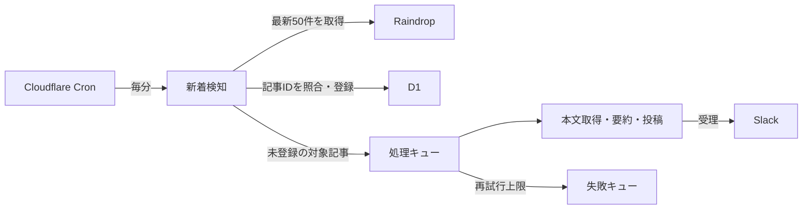

# Raindrop記事要約通知の設計

スマホの共有メニューとPCのRaindrop Webから普段どおり保存した公開記事を検知し、日本語の要約をSlackに届ける。個人のRaindropアカウント1つを対象とする。GitHubは公開リポジトリとする。

## 実装の分け方

最初はローカルのTypeScript CLIで、URLからSlack投稿までを通す。本文取得・要約・投稿はCLIとWorkerで共用する。各段階の動作を確認してから次の段階を実装する。

| 順番 | 変更 | 確認すること |
| --- | --- | --- |
| 1 | URLを手で指定 → 静的HTMLの本文 → Gemini → テスト用Slack | 公開記事1件の要約が届く。本文取得・要約・投稿の時間が測れ、取得不可なら元リンクが届く。認証情報はDopplerから読む。 |
| 2 | URLを手で指定 → Browser Run REST APIでJavaScript描画 → 同じ通知処理 | ローカルCLIからBrowser Runを直接呼び、静的HTMLでは本文が取れない記事の要約がテスト用Slackに届くことを確認する。描画の追加時間とブラウザー使用時間を測る。 [Browser RunのHTML取得API](https://developers.cloudflare.com/browser-run/quick-actions/content-endpoint/) |
| 3 | Raindropの最新1件 → 同じ通知処理 | `sort=-created&perpage=1` で取得した記事が届く。空の一覧では投稿しない。 |
| 4 | Raindropの最新1件 → ローカルSQLiteで既知IDを照合 → 同じ通知処理 | 事前登録したIDはスキップし、未知のIDは通知処理に渡す。DBの照合と登録をテストし、投入成功後にIDを書く順序はテスト用の投入先で確認する。 |
| 5 | Cloudflareの処理キューから同じ通知処理を呼ぶ | テストメッセージで投稿・再試行・失敗キューへの移送を確認する。段階2のRESTクライアントを共用し、同じ記事をWorker経由でも要約できることを確認する。 |
| 6 | D1への過去ID登録と毎分Cronを接続 | Raindropの最新50件を照合し、新着だけがキュー経由で届く。複数ページの過去IDを登録でき、投入が失敗したIDは次回も対象になる。スマホ・PCの普段の経路で保存し、検知とSlack受理までの時間を測る。 |

ローカルSQLiteは既知IDの照合とDBの書き込みを確認するために使う。自動運用のID登録は段階6で処理キューの投入成功に接続する。Cloudflare上の試験では段階別の時間、429、描画時間、抽出のCPU時間、Geminiの入力トークン数も測る。

## 自動運用時の構成

TypeScriptのWorkerを1つデプロイする。CloudflareでCron Trigger、D1、処理キュー、失敗キュー（dead-letter queue）を各1つ使う。Cloudflare WorkersとGemini APIは無料枠を使う。

## 起動とRaindropの監視

1. **初回セットアップ。** ローカルのセットアップスクリプトが対象コレクションを `sort=created&perpage=50` で古い順に読み、初回監視の基準時刻より前の `_id` から `INSERT OR IGNORE` のSQLを生成する。Wranglerにログインし、`npx wrangler d1 execute <DB名> --remote --file=<初回登録SQL>` でD1へ直接登録する。DB作成時に `article_ids` のスキーマを適用する。同じSQLで再実行できる。取得中の削除や監視範囲外への移動でページ境界がずれると、過去IDを取りこぼす場合がある。 [Raindropの一覧取得API](https://developer.raindrop.io/v1/raindrops/multiple) · [D1へのSQLファイル取り込み](https://developers.cloudflare.com/d1/best-practices/import-export-data/)
2. **起動。** D1への初回登録とDopplerへの接続確認が済んだら、`wrangler.jsonc` の `triggers.crons` に `["* * * * *"]` を設定してWorkerをデプロイする。Cloudflareが毎分 `scheduled()` を起動する。追加・変更・削除の反映には最大15分かかる場合がある。 [Cron Triggerの設定](https://developers.cloudflare.com/workers/configuration/cron-triggers/)
3. **1回分の監視。** `scheduled()` は `GET /rest/v1/raindrops/{collectionId}?sort=-created&perpage=50&page=0` を1回呼ぶ。50件はRaindrop APIの1ページ上限。対象記事の `_id` をD1の主キーで照合し、未登録の対象記事を `sendBatch()` で処理キューに送る。成功後に `INSERT OR IGNORE` で送信済みIDを登録する。投入に失敗した記事は次回も最新50件に含まれていれば再度対象になる。 [Raindropの一覧取得API](https://developer.raindrop.io/v1/raindrops/multiple) · [Queue書き込みの確定条件](https://developers.cloudflare.com/queues/configuration/javascript-apis/#queue)

Cron Triggerの最短間隔は1分。次の予定時刻までの待ちは通常0〜約60秒で、RaindropのAPI反映、Cronの起動遅延、キュー配信と記事処理の時間が加わる。 [CloudflareのCron式](https://developers.cloudflare.com/workers/configuration/cron-triggers/#supported-cron-expressions)

通常監視でRaindropの429・5xx・タイムアウトが起きた場合は、その回を記録して終了する。次はCronの通常の起動で取得し直す。他の4xxでは設定エラーをログに残す。セットアップ時の一覧取得で429が返った場合は、`X-RateLimit-Reset` まで待って同じページを再取得する。ヘッダーが欠けている場合は、分単位の制限を踏まえて60秒待つ。 [Raindropのレート制限](https://developer.raindrop.io/#rate-limiting)

## キューとレート制限

**1記事を1メッセージにする。** ペイロードは `{ id, url, title }`。`id` はRaindropの `_id`、`url` と `title` は検知時点の値。購読側がRaindropを引き直さずに処理でき、本文取得不可の通知にもRaindrop上のタイトルを使える。`sendBatch()` は複数の独立したメッセージを1回で送る。保存時刻と検知時刻は記事IDとともにログに残す。 [キュー送信API](https://developers.cloudflare.com/queues/configuration/javascript-apis/#queue)

購読処理の `max_batch_size=1` で `queue()` の1回の実行に1記事を対応させる。1件でバッチが満杯になるため、`max_batch_timeout` は既定値を使う。`max_concurrency` は省略して自動並列化に任せる。Freeの同時実行上限は250で、実際の並列度は負荷による。記事単位の `retry()` は自動並列化の実行エラーに数えられない。429が継続する場合は、どのサービスで発生したかを見て `max_concurrency` を調整する。 [バッチと個別の再試行](https://developers.cloudflare.com/queues/configuration/batching-retries/) · [自動並列化](https://developers.cloudflare.com/queues/configuration/consumer-concurrency/) · [同時実行上限](https://developers.cloudflare.com/queues/platform/limits/)

再試行の間隔はサービスの待機指示を優先する。たとえばSlackの429では `Retry-After` を使う。指示がなければ `retry_delay=60` とし、Geminiの分単位の制限を受けた直後に再送を繰り返すのを避ける。`max_retries=3` はCloudflareの既定値で、短い障害から数分で復帰する余地を残し、長引くものは `dead_letter_queue` に送る。Freeの処理キューの保持期限は24時間。 [Geminiのレート制限](https://aistudio.google.com/docs/rate-limits) · [Slackのレート制限](https://docs.slack.dev/apis/web-api/rate-limits/) · [キューの再試行と待機時間](https://developers.cloudflare.com/queues/configuration/batching-retries/) · [保持期限](https://developers.cloudflare.com/queues/platform/limits/)

## 本文取得と要約

1. `link` または `article` のHTTP(S) URLを対象にする。監視範囲には公開記事を保存する。ユーザー名・パスワード入りのURL、IPリテラル、単一ラベルや明示的なローカルホスト名は対象外とする。Workerの `fetch` でリダイレクト先にも同じ条件を適用し、ページ取得に認証ヘッダーやCookieを付けない。クエリ名で認証の有無は判定せず、元リンクのクエリは保持する。署名付きURLや非公開記事が監視範囲に入ると、URLはSlackに、取得できた本文はGeminiに渡り得る。 [Workersのリダイレクト仕様](https://developers.cloudflare.com/workers/runtime-apis/request/)
2. 公開HTMLを取得し、Node.jsとWorkersで共用できるHTMLパーサーで `article`、なければ `main` または `[role="main"]` の見出し・段落を抽出する。ナビゲーション、フッター、サイドバー、リンクだけの段落を除く。残った本文段落がなければ本文不足とする。
3. HTTP 200で本文不足なら、Browser Runの `POST /client/v4/accounts/{account_id}/browser-run/content` に最終URLを渡す。`gotoOptions` は `waitUntil: "networkidle2"`、`timeout: 10000`。レスポンスの `result` に含まれる描画後のHTMLを同じ抽出処理に通す。ローカルCLIとWorkerは同じ `fetch` ベースのクライアントを使う。 [描画後のHTML取得](https://developers.cloudflare.com/browser-run/quick-actions/content-endpoint/) · [レスポンス仕様](https://developers.cloudflare.com/api/resources/browser_rendering/subresources/content/methods/create/)
4. 抽出した本文をGemini Interactions APIに1回渡す。既定モデルは `gemini-3.5-flash-lite`。`store=false` でSlackに載せる短い日本語の要約を作り、本文中の命令は記事の内容として扱う。401・403でアクセスを拒否された場合や、描画後も本文を抽出できない場合は、取得不可と元リンクをSlackに送る。 [モデル仕様](https://aistudio.google.com/docs/models/gemini-3.5-flash-lite) · [Interactions API](https://aistudio.google.com/docs/interactions-overview)

以下は実測前の初期値。処理段階ごとの時間、HTMLのサイズ、要約できなかった記事を見て調整する。

| 設定 | 初期値の理由 |
| --- | --- |
| HTML取得・Slack投稿は各10秒 | 通常の処理で、ページ取得と投稿が外部サービス待ちを長引かせないよう、各段階に同じ上限を置く。HTML取得はリダイレクトと本文の読み込みを含む。 |
| Geminiは30秒 | 静的HTMLの取得・要約・投稿の通信待ちを合計50秒に抑える初期配分。生成にそのうち30秒を割り当てる。 |
| Browser Runのページ読み込みは10秒 | ページ読み込みの既定30秒より短くし、日次10分の枠を遅いページに使い過ぎないようにする。Quick Actions全体の実行時間は別に計測する。 [Quick Actionsのタイムアウト](https://developers.cloudflare.com/browser-run/reference/timeouts/) |
| HTMLは2 MiB | 通常のHTMLを受け取る余地を残しつつ、Workerのメモリ枠128 MBに対してページ1件の読み込み量を抑える。受信したHTMLのサイズで判定する。 [Workersのメモリ上限](https://developers.cloudflare.com/workers/platform/limits/#memory) |
| 手動リダイレクトは5回 | HTTPからHTTPSへの移行や正規URLへの転送が重なる場合に余地を残し、ループや長い転送は打ち切る。 |
| Geminiに渡す本文は先頭20,000文字 | HTMLの受信上限と別に、抽出後の1記事が分単位の入力トークン枠を占め過ぎるのを抑える。切り詰めの頻度と実際の入力トークン数を測る。長文では後半が要約から抜け得る。 |

Browser RunのFree枠は描画時間が1日10分、Quick Actionsがアカウントあたり10秒に1回。頻度制限による429は記事を再試行し、日次枠を使い切った場合は本文取得不可として扱う。`X-Browser-Ms-Used` を記録する。 [Freeの上限](https://developers.cloudflare.com/browser-run/limits/) · [使用時間ヘッダー](https://developers.cloudflare.com/browser-run/quick-actions/#test-quick-actions-locally)

## 記事IDと例外時の挙動

D1の `article_ids(id INTEGER PRIMARY KEY)` に、初回登録および投入成功したRaindropの `_id` を保持する。

| ケース | 挙動 |
| --- | --- |
| 過去の記事・既存IDの編集 | DBに登録済みのIDは投入しない。同じURLでも別IDで保存されれば別件として扱う。 |
| 監視停止・大量保存・API反映待ち | 記事が取得時に最新50件に入っていれば検知する。長時間の停止や大量保存で50件の外に押し出されたままの記事、取得前に削除された記事は拾えない。 |
| 監視の重複・投入直後の中断・再配信 | 2回の監視がID登録前に同じ記事を照合した場合や、投入成功からID登録までに中断した場合は再投入が起き得る。監視にはロックを持たず、この重複とCloudflareの再配信による通知の重複を許容する。 |
| Slackへの投稿 | 要約・取得不可のどちらも、HTTP 200かつ本文 `ok` でキューに確認応答（acknowledge）する。受理直後に応答が失われると、再試行で重複投稿が起き得る。 [Slackの成功応答](https://docs.slack.dev/messaging/sending-messages-using-incoming-webhooks/#handling-errors) |

記事を再試行する場合は、メッセージのURLから本文取得と要約をやり直す。投稿ではタイトルと要約をプレーンテキストにし、リンクの自動展開は無効にする。 [リンクの自動展開](https://docs.slack.dev/messaging/unfurling-links-in-messages/)

## 認証情報と運用

認証情報の保管先の初期案はDoppler Developerプラン。ローカル、Cloudflare上の実機確認、本運用で同じプロジェクトの設定を参照する。Raindrop・Gemini・Browser Runのキーは各1箇所で管理し、Slackはテスト用と本運用のWebhookを別のキー名で置く。DeveloperプランはCLI、API、サービス用トークンを利用できる。 [Dopplerのプラン](https://www.doppler.com/pricing)

| 値 | 用途 |
| --- | --- |
| `RAINDROP_TOKEN` | Raindrop Integrationsの自分用Test token。初回登録と監視の一覧取得に使う。 [Raindropの認証](https://developer.raindrop.io/v1/authentication/token) |
| `GEMINI_API_KEY` | AI Studioで発行し、記事の要約に使う。無料枠の入力・出力はサービス改善に使われ得る。 [APIキー](https://aistudio.google.com/docs/api-key) · [無料サービスのデータ取り扱い](https://aistudio.google.com/docs/terms#data-use-unpaid) |
| `BROWSER_RUN_API_TOKEN` | 対象のCloudflareアカウントに限定した `Browser Run - Edit` 権限のAPIトークン。段階2から描画時に使う。 [Quick ActionsのREST認証](https://developers.cloudflare.com/browser-run/quick-actions/#rest-api) |
| `SLACK_TEST_WEBHOOK_URL`、`SLACK_WEBHOOK_URL` | それぞれテスト用と本運用の投稿先。ローカルはテスト用を使う。 [Slack Incoming Webhooks](https://docs.slack.dev/messaging/sending-messages-using-incoming-webhooks/) |
| `CLOUDFLARE_ACCOUNT_ID` | Browser RunのREST APIの宛先を指定する設定値。 [Browser Runのエンドポイント](https://developers.cloudflare.com/browser-run/quick-actions/content-endpoint/#endpoint) |
| `RAINDROP_COLLECTION_ID`、`GEMINI_MODEL` | 運用時の環境変数。Raindropの未分類は `-1`、ゴミ箱以外の全体は `0`。監視先を変える場合は停止後に新しい範囲で初回登録を行う。 [コレクション指定](https://developer.raindrop.io/v1/raindrops/multiple) |

- **ローカル**では `doppler login` で認証し、`doppler run --no-fallback --only-secrets …` でCLIや初回登録スクリプトに必要な値だけを環境変数で渡す。公開CIはダミー値とモックを使う。 [Doppler CLI](https://docs.doppler.com/docs/cli)
- **Cloudflare上の確認と本運用**では、対象の設定を読める読み取り専用の `DOPPLER_TOKEN` をWorker Secretに登録する。各ハンドラーはDoppler APIからその処理に必要な値を1回で取得する。Dopplerにアクセスできない回は、監視は記録して終了し、記事処理はキューで再試行する。 [サービス用トークン](https://docs.doppler.com/docs/service-tokens) · [取得APIとレート制限](https://docs.doppler.com/reference/api) · [取得するキーの指定](https://docs.doppler.com/reference/secrets-download)

実機確認と本運用は同じWorkerを使う。Slackの宛先を切り替えるときは `triggers.crons` を空配列にしてデプロイし、停止の反映と処理キューの排出を確認する。Workerが読むWebhookのキー名を切り替え、既存のD1でCronを再開する。 [Cron Triggerの停止](https://developers.cloudflare.com/workers/configuration/cron-triggers/#remove-a-cron-trigger) · [Queuesの指標](https://developers.cloudflare.com/queues/observability/metrics/)

Wranglerでは `keep_vars=true`、`workers_dev=false`、`preview_urls=false` を指定する。公開リポジトリに実データ、初回登録SQL、`.wrangler/`、`.dev.vars*`、`.env*` を含めない。ログには記事ID・時刻・処理段階・エラー種別を記録し、実URL・本文・認証値・外部レスポンス本文を除外する。 [Wranglerの設定管理](https://developers.cloudflare.com/workers/wrangler/configuration/#source-of-truth)

毎分のCronで50件ずつ主キー照合する場合、D1の読み取りは約7.2万行／日が目安。D1 Freeは日次500万行読み取り・10万行書き込み、Queue Freeは日次10,000操作。 [D1料金](https://developers.cloudflare.com/d1/platform/pricing/) · [Queues料金](https://developers.cloudflare.com/queues/platform/pricing/)
